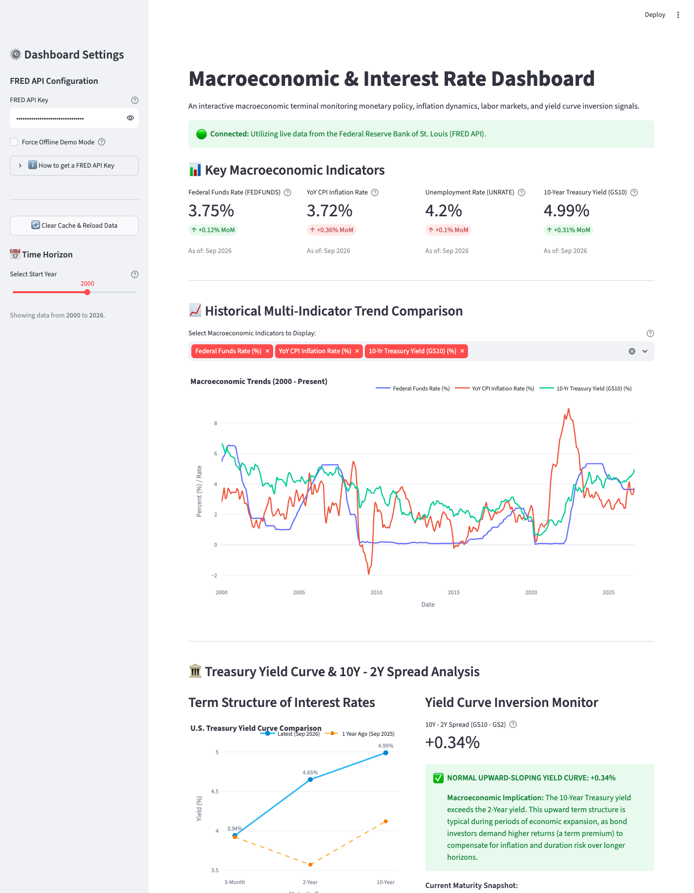

# Macroeconomic & Interest Rate Dashboard

An interactive, professional financial analytics dashboard built in Python using **Streamlit**, **Plotly**, and macroeconomic time series from the **Federal Reserve Bank of St. Louis Economic Data (FRED) API**.

This project provides financial analysts, economics students, and market participants with real-time tracking of monetary policy indicators, consumer inflation dynamics, labor market conditions, and sovereign bond yield curve inversion signals.



---

## 🌟 Key Features

1. **Top Macroeconomic KPI Cards**:
   - **Federal Funds Effective Rate (`FEDFUNDS`)**: Current target rate and month-over-month (MoM) change.
   - **YoY CPI Inflation Rate**: 12-month percentage change in consumer prices with MoM momentum.
   - **Unemployment Rate (`UNRATE`)**: National civilian unemployment percentage.
   - **10-Year Treasury Yield (`GS10`)**: Benchmark long-term sovereign bond rate.

2. **Interactive Multi-Select Historical Trend Chart**:
   - Compare any combination of key macro series across custom date ranges via an interactive start-year slider.
   - High-contrast Plotly line chart with unified hover tooltips, zoom/pan controls, and zero-inversion threshold line.

3. **Treasury Yield Curve & Inversion Monitor**:
   - Plots the term structure of interest rates across **3-Month (`TB3MS`)**, **2-Year (`GS2`)**, and **10-Year (`GS10`)** maturities.
   - Includes historical comparison against the yield curve from **1 year prior**.
   - Calculates the benchmark **10Y - 2Y Yield Spread** ($GS10 - GS2$).
   - **Automated Inversion Alert**: Triggers a dynamic warning banner if $GS10 - GS2 < 0$, highlighting historical recession implications.
   - Interactive historical spread chart with shaded recessionary inversion zones.

4. **Robust Error Handling & Demo Fallback**:
   - Resilient API client with timeout protection, missing data conversion (handles FRED `.` null markers), and status verification.
   - Built-in **Offline Demo Mode** with realistic historical synthetic series, ensuring full app usability even before an API key is configured.
   - Interactive sidebar allowing real-time API key configuration and cache clearing.

5. **Data Inspection & CSV Export**:
   - Tabular preview of all filtered macroeconomic series.
   - One-click CSV export for external modeling in Excel, Python, or R.

---

## 📐 Financial Methodology & Economic Theory

### 1. Year-over-Year (YoY) Inflation Rate Formula

The headline inflation metric represents the percentage change in the Consumer Price Index for All Urban Consumers (`CPIAUCSL`) over a 12-month period:

$$\text{YoY Inflation}_t = \left( \frac{\text{CPI}_t - \text{CPI}_{t-12}}{\text{CPI}_{t-12}} \right) \times 100$$

Where:
- $\text{CPI}_t$: Consumer Price Index level at month $t$.
- $\text{CPI}_{t-12}$: Consumer Price Index level 12 months prior.

**Economic Rationale**:
Unlike month-over-month (MoM) annualized rates which can exhibit high short-term volatility and seasonal noise, the 12-month YoY change provides a stable reading of medium-term price trajectory, directly aligning with the Federal Reserve's 2.0% inflation target framework.

---

### 2. The Yield Curve & 10Y - 2Y Spread Interpretation

The term structure of interest rates graphs the yields of similar-quality sovereign debt securities across increasing maturity tenors.

$$\text{Spread} = \text{Yield}_{\text{10-Year}} - \text{Yield}_{\text{2-Year}} = GS10 - GS2$$

#### Regimes:
- **Normal Upward Slope ($\text{Spread} > 0$)**:
  In a healthy economic expansion, longer-dated bonds yield more than shorter-dated bills. Investors demand a positive **term premium** to compensate for inflation uncertainty and duration risk over a decade-long investment horizon.
- **Flat Curve ($\text{Spread} \approx 0$)**:
  Signals macroeconomic uncertainty, transition periods between business cycle phases, or market ambiguity regarding future central bank actions.
- **Inverted Yield Curve ($\text{Spread} < 0$)**:
  Occurs when short-term yields exceed long-term yields. Under the **Expectations Hypothesis of the Term Structure**, short rates are pushed up by central bank monetary tightening to suppress inflation, while long-term rates decline as bond markets anticipate that aggressive tightening will slow growth and force the Federal Reserve to cut rates in the future.
- **Recession Indicator Track Record**:
  Sustained inversion of the 10Y - 2Y Treasury spread has preceded every U.S. economic recession over the past 50 years, with a typical lead time of 12 to 24 months before economic contraction begins.

---

## 📊 Federal Reserve Economic Data (FRED) Series Reference

| Series ID | Series Name | Frequency | Units | Source Description |
|---|---|---|---|---|
| `FEDFUNDS` | Federal Funds Effective Rate | Monthly | Percent | Overnight interbank lending rate for reserve balances |
| `CPIAUCSL` | Consumer Price Index (CPI-U) | Monthly | Index (1982-1984=100) | Headline price index across urban U.S. consumers |
| `UNRATE` | Civilian Unemployment Rate | Monthly | Percent | Percentage of labor force actively seeking employment |
| `GS10` | 10-Year Treasury Constant Maturity Rate | Monthly | Percent | Long-term benchmark risk-free borrowing yield |
| `GS2` | 2-Year Treasury Constant Maturity Rate | Monthly | Percent | Benchmark rate pricing near-term Fed policy expectations |
| `TB3MS` | 3-Month Treasury Bill Secondary Market Rate | Monthly | Percent | Ultra-short risk-free cash alternative rate |

---

## ⚙️ Installation & Setup Instructions

### Prerequisites
- Python 3.10+ (tested with Python 3.11, 3.12, 3.13, and 3.14)
- A FRED API key (free from St. Louis Fed)

### 1. Clone or Open the Repository
```bash
cd /path/to/Macro_Dashboard
```

### 2. Set Up a Python Virtual Environment
```bash
# Create the virtual environment
python3 -m venv venv

# Activate on macOS / Linux:
source venv/bin/activate

# (On Windows):
# .\venv\Scripts\activate
```

### 3. Install Dependencies
```bash
pip install -r requirements.txt
```

### 4. Configure FRED API Key
Create or edit the `.env` file in the project root:
```env
FRED_API_KEY=YOUR_FRED_API_KEY_HERE
```

> **How to get a free FRED API Key:**
> 1. Sign up for a free account at [FRED St. Louis](https://fred.stlouisfed.org/).
> 2. Go to **My Account** > **API Keys**.
> 3. Request an API key (approval is immediate).
> 4. Paste the 32-character key into `.env` or directly into the dashboard sidebar.

### 5. Launch the Dashboard
```bash
streamlit run app.py
```
The application will open in your default browser at `http://localhost:8501`.

---

## 🤖 Reflection on Building with Antigravity & Known Limitations

### Antigravity Development Reflection
Using the **Antigravity** coding assistant significantly streamlined the end-to-end development cycle:
1. **Full-Stack Project Scaffolding**: Antigravity autonomously configured the virtual environment, installed requisite libraries (`streamlit`, `pandas`, `plotly`, `requests`, `python-dotenv`), set up secure `.env` separation, and created `.gitignore` to prevent secret leakage.
2. **Domain-Specific Financial Logic**: Rapid translation of macroeconomic theory (annualized 12-month lag percent changes, term structure yield curve spreads, inversion flags) into vectorized `pandas` operations.
3. **Resilience & Graceful Degradation**: Antigravity designed a multi-tiered architecture that handles FRED API missing data symbols (`.`), network timeouts, and placeholder API keys by implementing a realistic synthetic historical data generator. This ensures the app is functional and demonstrable even in offline or unauthenticated environments.
4. **Interactive Visualization**: Designing synchronized Plotly charts with custom colorways, reference threshold annotations, and dual yield-curve overlays for direct financial analysis.

### Known Limitations & Future Enhancements
- **Monthly vs. Daily Granularity**: The core indicators in this dashboard (`CPIAUCSL`, `UNRATE`, `FEDFUNDS`, `GS10`, `GS2`, `TB3MS`) use monthly series for unified cross-indicator alignment. FRED also provides daily series for bond yields (`DGS10`, `DGS2`, `DTB3`), which could be incorporated for intra-month yield curve tracking.
- **Data Release Lags**: Macroeconomic series such as CPI and Unemployment are released with a 2-4 week reporting lag following the reference month, whereas financial market yields are instantaneous.
- **Predictive Modeling**: Future versions could incorporate a probit or logistic regression model to estimate empirical recession probability percentages directly from the 10Y - 2Y spread.
- **Monetary Policy Rule Modeling**: Adding a Taylor Rule simulation module comparing the actual Federal Funds rate against the Taylor Rule implied rate ($r^* + \pi + 0.5(\pi - \pi^*) + 0.5(y - y^*)$).

---

## 📄 License
This project is developed for educational and academic financial analysis purposes. Data courtesy of the Federal Reserve Bank of St. Louis.
# Macro_Dashboard
